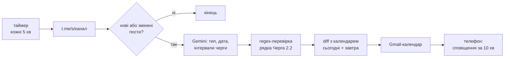

# Світло 2.2 у календарі: архітектура (пропозиція, 07.11.2026)

Особистий тимчасовий проєкт, до роботи HeadData не стосується, у ClickUp не заводимо. Документ на погодження: після твого "ок" і вибору варіанта запуску створюю окремий репо і реалізую. Принцип - **чим простіше, тим краще**.

**Естімейт:** базова 6 год -> 6 × 0,25 + 0,5 = 2 год (рекомендований варіант A).

## Мета

- Читати канал "Світло Голованівських ЕМ" і брати графік погодинних відключень (ГПВ) для **черги 2.2**.
- Писати в **твій Gmail-календар** (логін твоїм акаунтом) лише на **сьогодні і завтра**. Щойно з'являється новий графік або зміни - календар оновлюється.
- Сповіщення на телефоні **за 10 хвилин до вимкнення** і **за 10 хвилин до увімкнення** світла (їх надсилає сам Google Calendar).
- Можна налаштувати: канал, чергу, календар, за скільки хвилин нагадувати.

## Головне: юзербот не потрібен

Перевірив 07.11: це **публічний канал** (не група), і його пости видно без логіна:

- `https://t.me/s/SvitloHolovanivskohoRayonu` - звичайний HTML з останніми 20 постами (зараз #1715-#1734): повний текст, час (UTC), номер поста.
- Історія - `...?before=1715` (працює).
- Ім'я - `SvitloHolovanivskohoRayonu` (з малою `l` у "Svitlo").

Отже, Telethon, номер телефону і сесія не потрібні - достатньо звичайного HTTP-запиту раз на 5 хвилин.

## Що пише канал

| Тип поста | Приклад | Що робимо |
|---|---|---|
| Графік ГПВ на дату | #1731, 06.11 20:38: "07.11.2026 ... буде діяти наступний графік ... Черга 2.2: 02-04, 10-12, 14-16, 18-20" | Беремо інтервали черги |
| Зміни до ГПВ | #1729: "внесено зміни ... станом на 21:27 05.11.2026" | Повністю замінюємо графік на цю дату |
| Прогноз, ГОП | #1721, #1722 | Ігноруємо |
| СГАВ | #1732-#1734: "В 06:10 застосовано СГАВ 1, 2 чергу", "В 07:21 скасовано" | Поки не робимо (див. питання 3) |

Підводні камені (через них розбір іде через Gemini, а regex лише перевіряє):

- Час подається по-різному: `07:00-08:00`, `02-04`, `20-21:30`, `22-24` (24 - це 00:00 наступного дня).
- **Дата в шапці не дорівнює даті графіка:** #1725 "Зміни на 22:13 04.11.2026" - це зміни на **05.11**.
- Трапляються дублікати (#1732 і #1733) і відредаговані пости - звіряємо хеш тексту, а не лише номер поста.

## Як працює (однаково для всіх варіантів запуску)



1. **Збір:** HTML каналу -> пости; у стані зберігаємо хеші, тож Gemini викликається лише на нових постах (кілька разів на день).
2. **Розбір:** Gemini (`gemini-3.8-flash`, як у `transcribe.py`) повертає строгий JSON `{kind, target_date, intervals}`. Regex окремо витягує рядок `Черга 2.2: ...`. Якщо результати не збіглися, календар не чіпаємо і пишемо в лог.
3. **Розклад:** на дату діє останній пост ГПВ або змін. Суміжні інтервали склеюємо (`10-12, 12-14` -> 10:00-14:00; `22-24` + завтра `00-02` -> одне вимкнення), щоб не приходили зайві сповіщення.
4. **Календар:** на кожне вимкнення ставимо **дві події**, бо Google нагадує лише перед початком події:
   - "Світла немає" 02:00-04:00 - нагадування о 01:50;
   - "Світло повертається" о 04:00 (15 хв) - нагадування о 03:50.

   Синхронізуємо diff-ом: нове створюємо, зникле видаляємо, а однакове не чіпаємо, тож дублів не буде. Скрипт змінює лише свої події (за міткою), минулі події не чіпає. В описі події - лінк на пост.

### Налаштування

| Параметр | За замовчуванням | Що означає |
|---|---|---|
| `CHANNEL` | `SvitloHolovanivskohoRayonu` | Канал, за яким стежимо (будь-який публічний) |
| `QUEUE` | `2.2` | Черга ГПВ |
| `CALENDAR` | `Світло 2.2` | Назва або ID календаря; якщо такого немає - скрипт створює окремий; можна вказати й основний |
| `REMIND_MIN` | `10` | За скільки хвилин нагадувати |
| `DAYS` | `2` | Сьогодні + завтра |

## Де запустити: варіанти

| | Варіант | Логін Gmail | Працює, коли Mac вимкнено | Що налаштувати | Вартість |
|---|---|---|---|---|---|
| **A** | **Google Apps Script** (рекомендую) | Скрипт працює під твоїм акаунтом, достатньо один раз натиснути "Дозволити" | Так | Нічого: таймер вбудований | 0 |
| B | Python на Mac (launchd) | OAuth-клієнт у GCP + логін у браузері | **Ні** (оновить після пробудження) | OAuth consent screen | 0 |
| C | Python-контейнер: Cloud Run job + Scheduler (особистий GCP) | OAuth-клієнт, refresh-токен у Secret Manager | Так | Проєкт, білінг, OAuth, секрети, образ | ~0 (free tier) |
| D | Firebase: scheduled function (Python) | Як у C | Так | План Blaze (з білінгом) + як у C; під капотом той самий Cloud Run | ~0 |
| E | VM e2-micro (особистий акаунт) + Docker + cron | Як у C | Так | VM, Docker, оновлення ОС | 0 у free tier (лише регіони США) |

**Чому A.** Це сервіс без сервера: скрипт живе у твоєму Google-акаунті, а таймер "кожні 5 хвилин" вбудований. Календар доступний напряму (`CalendarApp`, нагадування - `addPopupReminder(10)`), без OAuth-клієнта, consent screen і токенів. Для B-E токен ще й "згорає" за 7 днів, якщо OAuth-застосунок лишився в статусі "Testing". Ліміти безкоштовні з великим запасом: 288 запусків на добу по кілька секунд.

**Мінуси A:** код - JavaScript, а не Python. Ключ Gemini з `.env` не читається напряму, тому при деплої скрипт сам кладе його в Apps Script (див. нижче), без ручного копіювання і без виводу ключа.

**Firebase** підходить, але це той самий Cloud Run, тільки з додатковим шаром (Blaze, firebase-tools), і з тими самими клопотами з OAuth. **VM** - найбільше обслуговування для такої маленької задачі. **Mac** - найпростіший для Python, але графік на завтра виходить о 20:00-22:00, а зміни - удень, тож якщо Mac спить, календар відстане.

Якщо принципово потрібен Python-контейнер - беремо C. Код той самий, а `Dockerfile` дозволяє запускати його і локально (B).

## Варіант A детально

- **Репо** `../svitlo-calendar` (`github.com/yevhenivanets/svitlo-calendar`, приватний). Тут лежить і цей документ (копія в `docs/`), щоб його легко було знайти.

```
svitlo-calendar/
  src/
    appsscript.json   # timeZone Europe/Kyiv, дозволи: Calendar, UrlFetch
    main.gs           # run(): fetch -> parse -> sync; setup(): таймер 5 хв
    fetch.gs  parse.gs  schedule.gs  calendar.gs
    config.gs         # значення за замовчуванням (таблиця вище)
  deploy.sh           # бере GEMINI_API_KEY з ../records/.env -> src/secret.gs (у .gitignore) -> clasp push
  tests/              # node-тести парсера на 20 збережених постах #1715-#1734
  docs/architecture.md
  README.md
```

- **Деплой:** `clasp` (CLI Apps Script від Google), одноразово `clasp login` твоїм Gmail. Далі `./deploy.sh` -> у редакторі Apps Script натиснути "Run setup" -> "Дозволити" (календар, зовнішні запити). Готово, таймер працює.
- **Зміна налаштувань:** без коду, у редакторі Apps Script -> Project settings -> Script properties (`CHANNEL`, `QUEUE`, `CALENDAR`, ...). Вони мають пріоритет над `config.gs`.
- **Стан** (хеші постів, графіки на дати) - у Script Properties, база не потрібна.
- **Помилки:** Apps Script сам надсилає на Gmail лист, якщо запуск за таймером упав (вбудована функція).
- **Телефон:** календар "Світло 2.2" з'явиться в Google Calendar на телефоні автоматично (той самий акаунт), сповіщення - стандартні.

## Етапи

1. **Парсер + тести** на 20 постах (усі формати вище) - перевіряю локально в node.
2. **Календар + таймер:** деплой, твоє "Дозволити", перевірка на сьогоднішньому і завтрашньому графіку, нагадування на телефоні.
3. **Тиждень спостереження**, далі - за потреби СГАВ.

## Відкриті питання

1. **Варіант запуску:** A (рекомендую) чи Python - C або B?
2. **Календар:** окремий "Світло 2.2" (рекомендую - його можна сховати одним кліком) чи основний?
3. **СГАВ:** черги СГАВ мають окрему нумерацію, це не ГПВ 2.2, а канал пише про СГАВ уже після факту ("В 06:10 застосовано"). Нагадування за 10 хв тут неможливе - лише подія "зараз вимкнули / скасовано". Чи це потрібно, і чи знаєш ти свою чергу СГАВ (її видно на kiroe.com.ua за адресою)?
4. Назви подій "Світла немає" / "Світло повертається" підходять?
